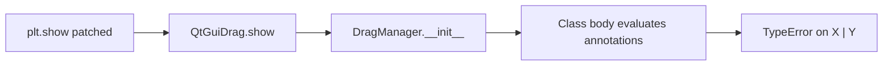

# Python 3.9 annotation compatibility (minimal fix)

## Root cause

Your traceback matches the known failure mode on **Python 3.9**:

```792:792:pylustrator/drag_helper.py
    def make_figure_draggable(self, fig: Figure | SubFigure) -> None:
```

Without postponed evaluation, annotations are **evaluated when the class body runs**. On 3.9, `Figure | SubFigure` is parsed as the bitwise `|` operator on types → `TypeError: unsupported operand type(s) for |: 'type' and 'type'`.

This happens during `DragManager.__init__` → nested `make_figure_draggable` definition → import of [`pylustrator/drag_helper.py`](pylustrator/drag_helper.py) from [`pylustrator/QtGuiDrag.py`](pylustrator/QtGuiDrag.py) on `plt.show()`.

[`pyproject.toml`](pyproject.toml) and [`.python-version`](.python-version) already target **3.9**; the bug is annotation syntax vs runtime, not a wrong floor version.



**Note:** Bitwise `|` in normal code (e.g. `DIR_X0 | DIR_Y0` in the same file) is unrelated and must stay untouched.

## Chosen fix (per your preference)

Add **one line** near the top of each affected module (after shebang/coding/comments, before imports):

```python
from __future__ import annotations
```

This postpones annotation evaluation (PEP 563 behavior on 3.9), so `X | Y` remains valid **source** syntax without 3.10 runtime semantics. No need to rewrite dozens of hints to `Union`/`Optional`.

## Files to touch (12 modules)

Each file below contains at least one PEP 604 union in a **type** position (parameters, returns, attributes, or module-level annotated globals):

| Module | Notable unions |
|--------|----------------|
| [`pylustrator/drag_helper.py`](pylustrator/drag_helper.py) | `Figure \| SubFigure`, `Artist \| Figure \| None`, … |
| [`pylustrator/helper_functions.py`](pylustrator/helper_functions.py) | Imported from [`__init__.py`](pylustrator/__init__.py) on package load |
| [`pylustrator/change_tracker.py`](pylustrator/change_tracker.py) | Module-level `stack_position: traceback.FrameSummary \| None` |
| [`pylustrator/snap.py`](pylustrator/snap.py) | `Tuple[...] \| Sequence[...] \| NDArray[...]` |
| [`pylustrator/parse_svg.py`](pylustrator/parse_svg.py) | `dict \| None`, `Patch \| list[Patch]` |
| [`pylustrator/lab_colormap.py`](pylustrator/lab_colormap.py) | `-> list \| None` |
| [`pylustrator/QLinkableWidgets.py`](pylustrator/QLinkableWidgets.py) | `pyqtBoundSignal \| None`, … |
| [`pylustrator/jupyter_cells.py`](pylustrator/jupyter_cells.py) | nested `str \| None` fields |
| [`pylustrator/components/plot_layout.py`](pylustrator/components/plot_layout.py) | Qt widget unions |
| [`pylustrator/components/matplotlibwidget.py`](pylustrator/components/matplotlibwidget.py) | `QTimer \| None` |
| [`pylustrator/components/tree_view.py`](pylustrator/components/tree_view.py) | mixed with existing `Optional[...]` |
| [`pylustrator/components/qitem_properties.py`](pylustrator/components/qitem_properties.py) | `Artist \| List[Artist] \| None` |

**Placement convention:** Match existing file headers (e.g. in [`drag_helper.py`](pylustrator/drag_helper.py), insert immediately before the first `import` block, after the GPL comment block — same pattern in all 12 files).

**Out of scope (already 3.9-safe):** `list[...]` / `dict[...]` (PEP 585, OK on 3.9), legacy `Optional`/`List`/`Dict` elsewhere, no `match`/`case` usage.

## Verification

1. **Import smoke test** on Python 3.9 (matches your notebook venv):
   - `uv run python -c "import pylustrator; from pylustrator.drag_helper import DragManager"`
   - Should complete without `TypeError` on `|`.

2. **Existing CI-equivalent checks** (repo already pins 3.9 via [`.python-version`](.python-version)):
   - `QT_QPA_PLATFORM=offscreen uv run pytest`
   - `uv run ty check` ([`ty.toml`](ty.toml) already uses `python-version = "3.9"`)

3. **Optional manual repro:** run your `plt.show()` path that previously failed after installing this tree into the Spike3D venv (`pip install -e .` or equivalent).

## What we are not changing

- No bump of `requires-python` (stays `>=3.9`).
- No mass rewrite of `|` → `Union`.
- No new dependency on `typing_extensions`.
- No CI matrix expansion unless you ask later (current workflow already uses 3.9 via uv).
